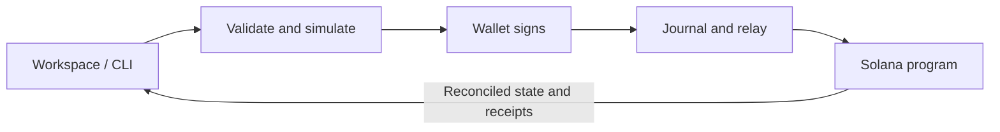

# BondTrace

### Coupon payments, bond redemption and holder voting on Solana.

BondTrace gives issuers a workspace for servicing tokenized bonds **after issuance**: identify eligible holders, calculate what each is owed, settle the action and retain verifiable on-chain evidence.

**[Try the application](https://bondtrace-devnet.onrender.com/?view=overview&instrument=9AcsZYk2WhSKzuK8m6gwy26Tb4JcWiQ9MpTyaYbfmqqh)** · **[Watch the demo · EN](https://youtu.be/arOCHtruN_Q)** · **[Демо на русском](https://youtu.be/Izo33Mry-hc)** · [Project pitch](https://youtu.be/3t2nP0fGRtI)

[Русский README](README.ru.md) · [Corporate actions](#corporate-actions) · [Architecture](#architecture) · [Run locally](#run-locally) · [Code map](#repository-map) · [Verification](#verification)

Built for the **Superteam Kazakhstan × KASE** side track. Working **devnet prototype** with synthetic SPL test assets.

[](https://bondtrace-devnet.onrender.com/?view=overview&instrument=9AcsZYk2WhSKzuK8m6gwy26Tb4JcWiQ9MpTyaYbfmqqh)

*Actual public workspace, captured 12 October 2026. English, Russian and Kazakh; desktop and phone layouts; local time-zone display. The image shows a completed test issue; transaction receipts establish execution.*

## Why this exists

A tokenized bond still needs answers to three questions: **who gets paid, how much, and when?** Transfers, record dates and maturity make those answers depend on historical rights rather than today's balance.

BondTrace connects that lifecycle in one issuer/holder workspace. Record-date snapshots fix eligibility, exact arithmetic calculates entitlements, and payment records show what has settled. Historical coupon rights survive transfers and principal retirement. Due v4 snapshots can be advanced by any fee payer; a holder signs their own principal payment and burn.

## Corporate actions

| Action | Implemented flow | On-chain evidence |
|---|---|---|
| **Coupon payment** | Fix record-date quantities, calculate entitlements and pay the fixed beneficiary once | Snapshot, per-holder paid bit, SPL transfer |
| **Bond redemption** | Capture maturity rights, pay principal and burn the matching bonds atomically | Principal snapshot, payment, burn, remaining obligations |
| **Holder voting** | Fix snapshot weights, record one ballot per holder and close the proposal | Weights, ballots and totals; informational vote |

**Recorded public devnet result:** 10 test bonds → **500 coupon units · 10,000 principal units · 10 bonds burned**. Vote: **10 for / 0 against**. Eighteen signatures were observed finalized: 17 business actions and one auxiliary synthetic-token mint. An actual service restart preserved the same 17 action IDs and financial results. [Transaction receipts](docs/evidence/hosted-v4-lifecycle-20261011.json) · [Restart recovery](docs/evidence/hosted-v4-recovery-20261011.json).

The [requirements map](docs/08-SPEC.md) covers the test instrument, registry, record-date mechanism, entitlement math, all three actions and verifiable outcomes.

<details>
<summary>Entitlement example and precision rules</summary>

```text
Coupon    = record-date bonds × face value × annual rate ÷ frequency
Principal = maturity bonds × face value

10 bonds × 1,000 × 10% ÷ 2 = 500 per coupon
10 bonds × 1,000           = 10,000 principal
```

Bond tokens have 0 decimals; settlement tokens have 6. Rust uses checked integers, TypeScript uses BigInt, and JSON transmits integer strings. A fractional settlement base unit is rejected instead of silently rounded. Final coupon and principal are separate entitlements: a principal burn never erases an unpaid historical coupon. [Exact calculations](TECHNICAL.md).

</details>

## Why Solana

- **Atomic settlement:** the program pays principal and burns the corresponding SPL bonds in one transaction.
- **Persistent action state:** program-owned accounts retain holder rights, paid masks and voting records independently of the web service.
- **Inspectable execution:** SPL transfers, burns and program transactions produce receipts that can be checked against the action accounts.

BondTrace's SPL bond tokens remain frozen outside program-controlled transfers. These are implemented protocol choices; no throughput, cost or production-scale benchmark is claimed.

## Architecture



The API commits the operation ID, original signed bytes and transaction lifetime **before relay**. Uncertain outcomes are reconciled with the same ID; passive GET requests never relay transactions. Local operation uses SQLite; hosted recovery uses Neon PostgreSQL with a single-writer fence. An uncertain database commit blocks further signing/relay.

| Layer | Stack | Start reading |
|---|---|---|
| On-chain rules | Rust · Anchor · classic SPL Token | [Program](programs/bondtrace/src/v2.rs), [accounts](programs/bondtrace/src/v2_state.rs) |
| Client and exact math | TypeScript · Solana Kit · BigInt | [Typed client](packages/client/src/program.ts), [domain math](packages/client/src/domain.ts) |
| API and recovery | TypeScript · Node.js · SQLite / PostgreSQL | [Server](server), [API contract](docs/15-API-CONTRACT.md) |
| Issuer/holder workspace | React · Vite · TypeScript | [Frontend](apps/web/src) |
| Execution checks | Node test runner · LiteSVM · local validator | [Tests](tests), [verification history](docs/VERIFICATION-HISTORY.md) |

For account layouts, record-date logic, entitlement calculations, settlement and Solana components, read **[TECHNICAL.md](TECHNICAL.md)**. [Protocol limits](docs/34-PAGED-SERVICING.md) · [Security model](docs/11-SECURITY.md) · [Hosting and recovery](docs/31-HOSTING.md).

## Run locally

The public application can be inspected without a password or wallet. Render Free may take time to wake. Open a payment, inspect its holders and follow its transaction receipt in Solana Explorer.

For the reproducible **Windows x64 / PowerShell 7 / Node 22.14.0 / WSL2 Ubuntu 24.04** lifecycle:

```powershell
git clone --depth 1 https://github.com/dimik98330/solana-worldsfair-2026.git
cd solana-worldsfair-2026
npm ci --ignore-scripts
npm run setup:judge
npm run demo:paged:lifecycle
```

The launcher builds the program, starts an isolated validator/API and uses generated test signers to run issuance → record dates → voting → transfer → coupons → principal/burn → an old coupon after retirement.

**Application/API:** `http://127.0.0.1:3200` · **RPC:** `http://127.0.0.1:8999`.

First-time toolchain installation takes longer than a prepared run. **[Full setup, prerequisites and native Linux instructions](docs/LOCALNET-SETUP.md)**. After interruption, preserve the printed recovery ID and resume with the same flags plus `-OperationId <id>`; retain the original journal.

## Repository map

| Folder | What is here |
|---|---|
| [`apps/web`](apps/web) | React issuer and holder workspace |
| [`programs/bondtrace`](programs/bondtrace) | Solana program, account constraints and SPL actions |
| [`server`](server) | API, transaction preparation, durable journal and reconciliation |
| [`packages/client`](packages/client) | Instruction encoding, account decoding and exact arithmetic |
| [`tests`](tests) | Business rules, compiled-program execution and recovery cases |
| [`scripts`](scripts) | Toolchain setup, lifecycle reproduction and verification |
| [`docs`](docs/README.md) | Technical contracts, setup, scope and evidence index |
| [`docs/evidence`](docs/evidence) | Versioned transaction packets, recovery results and UI captures |

## Verification

Start with the **[public v4 transaction packet](docs/evidence/hosted-v4-lifecycle-20261011.json)**, **[same-ID restart check](docs/evidence/hosted-v4-recovery-20261011.json)** and **[deployment record](docs/33-HOSTED-DEPLOYMENT.md)**. Source, deployed program and recorded cohorts are versioned separately.

<details>
<summary>Earlier runs and larger localnet scenarios</summary>

| Recorded run | Result | Evidence |
|---|---|---|
| Public devnet v3 | 900 coupon units, 18,000 principal, 18 bonds burned; 26 finalized signatures; restart recovery | [Original packet](docs/evidence/hosted-devnet-20261009.json) |
| Prepared localnet v4 | 1,800 coupon units, 18,000 principal, 18 burned; 37 signatures observed finalized at its cutoff | [Independent result](docs/evidence/servicing-v4-one-command-check-20261010.json) |
| Larger localnet v4 | 33 initial holders, a later receiver, 9 coupons; 21,600 coupon units and 48,000 principal; late coupon after burn | [Result and scope](docs/evidence/servicing-v4-localnet-summary-20261010.json) |

These are separate cohorts, not combined totals. Older signature statuses may no longer be recoverable from a later RPC query; original receipts, observations and failed attempts remain in [verification history](docs/VERIFICATION-HISTORY.md).

</details>

<details>
<summary>Run the source checks</summary>

```powershell
npm run typecheck
npm test
npm run test:ui
npm run build
npm run test:program
# Optional disposable PostgreSQL fixture; never an application database:
npm run test:postgres
```

Checks cover entitlements, overflow/remainders, record locks, wrong authorities, duplicate payments/votes, partial capture, coupon rights after burn and durable recovery. Prerequisites and recorded test scope are documented in [setup](docs/LOCALNET-SETUP.md) and [verification history](docs/VERIFICATION-HISTORY.md).

</details>

## Prototype scope and next validation

All assets are **synthetic test tokens with no fiat value**. The on-chain corporate-action flow is functional; registry/settlement adapters operate in **sandbox/shadow mode**. A bank acknowledgement cannot mark an on-chain obligation paid or authorize real bank dispatch. There is **no live bank, KASE or custodian connection**.

An ordinary human Phantom transaction remains **unverified**, although the full-wire v0 sign-only path and signature checks are implemented. Wallet connection alone is not transaction success. Ordinary SPL/DEX transfers, legal ownership/KYC, fiat custody, an institutional pilot and production availability are outside the demonstrated scope. Protocol pages hold 8 entries, the browser accepts up to 16 coupons, and complete API reads have a 4,096-account budget.

Next validation steps are a witnessed human-wallet lifecycle and an independently agreed institutional sandbox pilot. Sandbox pilot acceptance criteria live in the [pilot contract](docs/integrations/PILOT-CONTRACT.md) and [runbook](docs/integrations/PILOT-RUNBOOK.md); no pilot or production audit is claimed.

## Demo, builder and submissions

| Material | What it shows |
|---|---|
| [English demo · 2:43](https://youtu.be/arOCHtruN_Q) | Continuous inspection of the completed **public devnet** issue; disclosed synthetic English narration |
| [Русское демо · 2:30](https://youtu.be/Izo33Mry-hc) | Continuous **localnet** walkthrough with the owner's original voice |
| [Project pitch · 1:56](https://youtu.be/3t2nP0fGRtI) | Separate product presentation; disclosed synthetic English narration |
| [English project thread](https://x.com/dimasmitth/status/2109595448805835134) | Purpose, workflow and inspection links |

The demos show recorded outcomes and real browser input; they execute no new payment or ordinary human-wallet signature. [Media provenance](docs/13-DEMO.md).

Solo project by **[dimik98330](https://github.com/dimik98330)**. AI tools assisted implementation and review. Submitted to **[Colosseum Crypto World's Fair](https://colosseum.com/arena/projects/bondtrace)** and the separate **Superteam Kazakhstan × KASE side track** on 12 October 2026. Submitted status is recorded separately from eligibility, judging and prizes. [Submission record](docs/14-SUBMISSION.md) · [Portal evidence](docs/evidence/kase-submission-20261012.json).

**[Documentation index](docs/README.md)** · [Technical overview](TECHNICAL.md) · [Publication history](docs/PUBLICATION.md)
