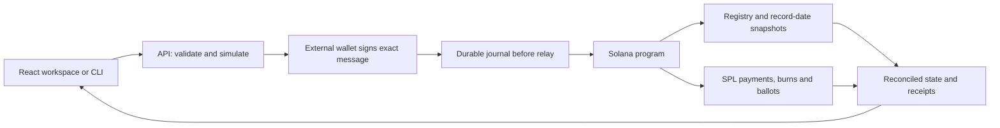

# BondTrace

**English** · [Русский](README.ru.md)

**From a bondholder’s recorded entitlement to a verifiable payment.**

BondTrace is a working corporate-actions prototype on **Solana**, built for **Superteam Kazakhstan × KASE**. It services the bond after issuance: coupon payments, maturity redemption with atomic token burns, and bondholder voting.

**[Open application](https://bondtrace-devnet.onrender.com/)** · **[Inspect the completed v4 issue](https://bondtrace-devnet.onrender.com/?view=overview&instrument=9AcsZYk2WhSKzuK8m6gwy26Tb4JcWiQ9MpTyaYbfmqqh)** · **[Technical overview](TECHNICAL.md)** · **[English demo · 2:43](https://youtu.be/arOCHtruN_Q)** · **[Project pitch · 1:56](https://youtu.be/3t2nP0fGRtI)**

**Verified on public devnet:** 10 test bonds → **500 coupon + 10,000 principal + 10 bonds burned**, with a recorded holder vote. Eighteen signatures were observed finalized; the same records survived a service restart. [Transactions](docs/evidence/hosted-v4-lifecycle-20261011.json) · [Recovery](docs/evidence/hosted-v4-recovery-20261011.json).

## Why it matters

Issuance creates a token. Servicing must establish who is owed what, pay the correct beneficiary once, and retain the evidence when transfers, maturity or a service restart intervene.

BondTrace ties these steps together with on-chain record-date rights, exact integer calculations and recoverable settlement. Historical coupon rights survive a transfer or principal burn. Any fee payer can advance due v4 snapshots; the issuer does not need to remain online at maturity. A holder signs their own principal payment and burn.

## Try it

Open the application and inspect payments, holders, voting and transaction receipts. Public inspection requires no password. The application supports **English, Russian and Kazakh**, desktop and phone layouts, and local time-zone display. Receipt links open the corresponding Solana Explorer transaction.

All assets are **synthetic test SPL tokens**, with no fiat value. Render Free can sleep between visits. A connected wallet proves connection; it does not prove a completed transaction.

| Surface | Verified scope |
|---|---|
| Public application | Current v4 program and workspace are deployed; public JS/CSS match the reviewed build. Coupon 500, principal 10,000, burn 10 and voting passed through the public API, with 18 finalized signatures and same-ID recovery after restart. [Deployment record](docs/33-HOSTED-DEPLOYMENT.md). |
| Current source | Paged v4 program, current multilingual workspace, permissionless due servicing and signed shadow adapters. Source and deployment versions are tracked separately. [Readiness](docs/35-READINESS.md). |
| Ordinary Phantom | Full-wire v0 sign-only path and signature checks are implemented. A successful ordinary human-wallet transaction remains unverified. |
| Institutional connections | Registry attestations, settlement outbox and signed acknowledgements work in a sandbox/shadow flow. No live KASE, bank or custodian integration is claimed. |


*Current public workspace reading the completed v4 test issue, 12 October 2026 in Kazakhstan. Financial execution is established by the linked receipts; this screenshot does not establish human-wallet signing.*

## The three required scenarios

| Scenario | What happens | What remains verifiable |
|---|---|---|
| **Coupon payment** | Freeze eligible holder quantities at the record cutoff, calculate each entitlement, then claim or execute a payment to the fixed beneficiary | Snapshot, per-holder paid bit, SPL transfer and transaction receipt |
| **Bond redemption** | Capture maturity holdings; each holder receives principal and burns the matching bonds in one atomic transaction | Principal snapshot, payment, burn and remaining obligations |
| **Bondholder voting** | Fix voting weights, accept one ballot per holder, and close the proposal | Recorded weights, ballots and totals; the vote is informational |

The test instrument, holder registry, record-date mechanism, entitlement calculation and resulting action accounts are implemented in the [Solana program](programs/bondtrace/src/v2.rs). The [acceptance map](docs/08-SPEC.md) covers all eight minimum requirements.

```text
Coupon    = record-date bonds × face value × annual rate ÷ frequency
Principal = maturity bonds × face value

10 bonds × 1,000 × 10% ÷ 2 = 500 per coupon
10 bonds × 1,000           = 10,000 principal
```

Bond units have 0 decimals; settlement tokens have 6. Rust uses checked integers, TypeScript uses BigInt, and JSON transmits integer strings. A fractional settlement base unit is rejected rather than silently rounded. Final coupons and principal are separate entitlements: principal retirement never erases an unpaid historical coupon.

## How it works



- **Solana is authoritative.** Immutable terms, paged registry, snapshots, payment masks and ballots enforce the action. Classic SPL bonds remain frozen outside controlled program transfers.
- **Settlement is recoverable.** The API retains the operation ID, signed bytes and transaction lifetime before sending. An uncertain outcome is reconciled before a new action. GET requests never relay transactions.
- **Storage survives hosting restarts.** Local operation uses SQLite; the hosted service uses Neon PostgreSQL with a single-writer fence. An uncertain database commit blocks further signing/relay.
- **External rails have an explicit boundary.** Signed registry/settlement adapters support audit and shadow reconciliation. A bank acknowledgement cannot mark an on-chain obligation paid or authorize real bank dispatch.

[Architecture, record dates and arithmetic](TECHNICAL.md) · [Protocol and limits](docs/34-PAGED-SERVICING.md) · [API](docs/15-API-CONTRACT.md) · [Security model](docs/11-SECURITY.md)

## Reproduce the v4 lifecycle

For **Windows x64 + PowerShell 7 + Node 22.14.0 + WSL2/Ubuntu 24.04**:

```powershell
git clone --depth 1 https://github.com/dimik98330/solana-worldsfair-2026.git
cd solana-worldsfair-2026
npm ci --ignore-scripts
npm run setup:judge
npm run demo:paged:lifecycle
```

The launcher builds the program, starts an isolated validator/API, creates a test bond, distributes 10/5/3 units, fixes rights, votes, transfers, settles coupons, redeems principal and claims an old coupon after burn. It uses generated local test signers. **Application/API: `http://127.0.0.1:3200`; RPC: `http://127.0.0.1:8999`.**

First-time toolchain installation takes longer than a prepared run. [Setup and native Linux instructions](docs/LOCALNET-SETUP.md). On interruption, preserve the printed recovery ID and resume with the same flags plus `-OperationId <id>`; do not delete the journal or create replacement payments.

## Evidence you can inspect

| Recorded run | Result | Evidence |
|---|---|---|
| Public devnet v4 | 500 coupon units, 10,000 principal, 10 bonds burned; 10 votes for/0 against; 18 signatures observed finalized; same 17 action IDs and results after restart | [Transaction packet](docs/evidence/hosted-v4-lifecycle-20261011.json), [restart recovery](docs/evidence/hosted-v4-recovery-20261011.json) |
| Public devnet v3 | 900 coupon units, 18,000 principal, 18 bonds burned; 26 finalized signatures; restart recovery | [Public transaction packet](docs/evidence/hosted-devnet-20261009.json) |
| Prepared localnet v4 launcher | 1,800 coupon units, 18,000 principal, 18 burned; 37 signatures observed finalized at the recorded cutoff | [Independent result](docs/evidence/servicing-v4-one-command-check-20261010.json) |
| Larger localnet v4 scenario | 33 initial holders, a later receiver, 9 coupons; 21,600 coupon units and 48,000 principal; late coupon after burn | [Results and exact scope](docs/evidence/servicing-v4-localnet-summary-20261010.json) |

These are separate cohorts and versions. Later RPC queries cannot always recover older statuses; the original receipts and their observation times remain preserved. [Verification history](docs/VERIFICATION-HISTORY.md) records exact source revisions, failed attempts, test results and exclusions.

```powershell
npm run typecheck
npm test
npm run test:ui
npm run build
npm run test:program
# Optional disposable PostgreSQL fixture; never an application database:
npm run test:postgres
```

Tests cover exact entitlements, overflow/remainders, record locks, wrong authorities, duplicate payments/votes, partial capture, historical rights after burn and storage recovery. They remain in the repository because they make the prototype reviewable and reproducible.

## Prototype boundaries

This is a permissioned test-bond servicing prototype, not a production securities venue. Ordinary SPL/DEX transfers, legal ownership/KYC, fiat custody, a real institutional pilot and production availability are outside the demonstrated scope. Protocol pages hold 8 entries; the browser accepts up to 16 coupons, and complete API reads have a 4,096-account budget. These are explicit limits, not unlimited-scale claims.

The [English demo](https://youtu.be/arOCHtruN_Q) continuously inspects the completed **public devnet** issue with real browser input. The [separate pitch](https://youtu.be/3t2nP0fGRtI) explains the product and founder background. Both use disclosed synthetic English narration; the demo executes no new payment or human-wallet signature. [Video provenance and scope](docs/13-DEMO.md).

The [Russian owner-narrated demo · 2:30](https://youtu.be/Izo33Mry-hc) is also available on YouTube: one continuous take of a completed **localnet** test issue. The [English project thread](https://x.com/dimasmitth/status/2109595448805835134) explains the purpose, workflow and inspection links.

The owner submitted BondTrace to **Colosseum Crypto World's Fair** and the separate **Superteam Kazakhstan × KASE side track** on 12 October 2026. Colosseum records **Submitted / entered for judging**; the KASE portal shows **Edit Submission**, with all 12 saved content fields read back. No official score, prize outcome or KASE endorsement is asserted. [Submission records](docs/14-SUBMISSION.md).

## Repository map

`apps/web` — React workspace · `server` — API, recovery and storage · `programs/bondtrace` — Anchor program · `packages/client` — typed client and exact math · `tests` — behavior and failure cases · `scripts` — setup and reproduction · `docs/evidence` — versioned proofs.

[Documentation index](docs/README.md) · [Hosting and recovery](docs/31-HOSTING.md) · [Cleanup history](docs/PUBLICATION.md)
