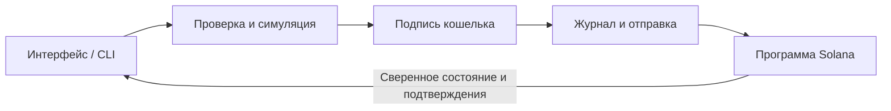

# BondTrace

### Купоны, погашение облигаций и голосование держателей на Solana.

BondTrace — рабочее пространство эмитента для обслуживания токенизированных облигаций **после выпуска**: определить получателей, точно рассчитать выплаты, выполнить действие и сохранить проверяемое доказательство в блокчейне.

**[Открыть приложение](https://bondtrace-devnet.onrender.com/?view=overview&instrument=9AcsZYk2WhSKzuK8m6gwy26Tb4JcWiQ9MpTyaYbfmqqh)** · **[Демо на русском](https://youtu.be/Izo33Mry-hc)** · **[English demo](https://youtu.be/arOCHtruN_Q)** · [Питч проекта](https://youtu.be/3t2nP0fGRtI)

[English README](README.md) · [Корпоративные действия](#корпоративные-действия) · [Архитектура](#архитектура) · [Локальный запуск](#локальный-запуск) · [Карта репозитория](#карта-репозитория) · [Проверка результатов](#проверка-результатов)

Проект для side track **Superteam Kazakhstan × KASE**. Работающий прототип в **devnet** с синтетическими тестовыми SPL-активами.

[](https://bondtrace-devnet.onrender.com/?view=overview&instrument=9AcsZYk2WhSKzuK8m6gwy26Tb4JcWiQ9MpTyaYbfmqqh)

*Настоящий публичный интерфейс, снимок 12 октября 2026 года. Английский, русский и казахский языки; компьютер и телефон; локальный часовой пояс. На изображении завершённый тестовый выпуск; исполнение подтверждают отдельные транзакции.*

## Зачем нужен проект

После токенизации облигации остаются три вопроса: **кому платить, сколько и когда?** Из-за переводов, дат фиксации и погашения ответы зависят от исторических прав, а не только от текущего баланса.

BondTrace связывает этот цикл в одном интерфейсе эмитента и держателя. Снимки на дату фиксации определяют получателей, точная арифметика рассчитывает суммы, а записи выплат показывают исполнение. Купонные права сохраняются после перевода или погашения номинала. Наступившие v4-снимки может продвинуть любой плательщик комиссии; держатель сам подписывает выплату своего номинала и сжигание.

## Корпоративные действия

| Действие | Реализованный процесс | Доказательство в блокчейне |
|---|---|---|
| **Купон** | Зафиксировать количество облигаций, рассчитать право и один раз выплатить закреплённому получателю | Снимок, отметка выплаты держателю, SPL-перевод |
| **Погашение** | Зафиксировать права на дату погашения, атомарно выплатить номинал и сжечь соответствующие облигации | Снимок номинала, выплата, burn, остаток обязательств |
| **Голосование** | Зафиксировать веса, принять один бюллетень от держателя и закрыть предложение | Веса, бюллетени и итоги; информационное голосование |

**Зафиксированный результат публичного devnet:** 10 тестовых облигаций → **500 единиц купона · 10 000 номинала · 10 облигаций сожжено**. Голосование: **10 за / 0 против**. Наблюдались 18 подписей в finalized: 17 бизнес-действий и один вспомогательный выпуск синтетических токенов. После настоящего перезапуска сервиса сохранились те же 17 идентификаторов и финансовые результаты. [Транзакции](docs/evidence/hosted-v4-lifecycle-20261011.json) · [Восстановление](docs/evidence/hosted-v4-recovery-20261011.json).

[Карта требований](docs/08-SPEC.md) покрывает тестовый инструмент, реестр, дату фиксации, расчёт прав, все три действия и проверяемые результаты.

<details>
<summary>Пример расчёта и правила точности</summary>

```text
Купон   = облигации на дату фиксации × номинал × годовая ставка ÷ частота
Номинал = облигации на дату погашения × номинал

10 облигаций × 1 000 × 10% ÷ 2 = 500 за купон
10 облигаций × 1 000           = 10 000 номинала
```

Облигации имеют 0 знаков после запятой, расчётные токены — 6. В Rust используются проверяемые целые числа, в TypeScript — BigInt, в JSON — строки целых чисел. Дробная базовая единица отклоняется вместо скрытого округления. Последний купон и номинал — отдельные права: сжигание при погашении не удаляет невыплаченный исторический купон. [Точные расчёты](TECHNICAL.md).

</details>

## Почему Solana

- **Атомарный расчёт:** программа выплачивает номинал и сжигает соответствующие SPL-облигации в одной транзакции.
- **Состояние корпоративного действия:** программные аккаунты сохраняют права держателей, отметки выплат и голоса независимо от веб-сервиса.
- **Проверяемое исполнение:** переводы SPL, сжигание и вызовы программы дают подтверждения, которые можно сопоставить с аккаунтами действия.

SPL-токены облигаций BondTrace заморожены вне контролируемых переводов программы. Это реализованные свойства протокола; бенчмарки скорости, стоимости или промышленного масштаба не заявляются.

## Архитектура



API сохраняет идентификатор операции, исходные подписанные байты и срок жизни транзакции **до отправки**. Неопределённый результат сверяется с тем же ID; пассивные GET-запросы не отправляют транзакции. Локально используется SQLite, на хостинге — Neon PostgreSQL с защитой от нескольких писателей. Неопределённый commit базы блокирует дальнейшее подписание и отправку.

| Слой | Стек | Откуда начать чтение |
|---|---|---|
| Правила в блокчейне | Rust · Anchor · классический SPL Token | [Программа](programs/bondtrace/src/v2.rs), [аккаунты](programs/bondtrace/src/v2_state.rs) |
| Клиент и точная арифметика | TypeScript · Solana Kit · BigInt | [Типизированный клиент](packages/client/src/program.ts), [расчёты](packages/client/src/domain.ts) |
| API и восстановление | TypeScript · Node.js · SQLite / PostgreSQL | [Сервер](server), [контракт API](docs/15-API-CONTRACT.md) |
| Интерфейс эмитента и держателя | React · Vite · TypeScript | [Фронтенд](apps/web/src) |
| Проверки исполнения | Node test runner · LiteSVM · локальный валидатор | [Тесты](tests), [история проверок](docs/VERIFICATION-HISTORY.md) |

Аккаунты, даты фиксации, расчёты, исполнение и компоненты Solana описаны в **[TECHNICAL.md](TECHNICAL.md)**. [Ограничения протокола](docs/34-PAGED-SERVICING.md) · [Модель безопасности](docs/11-SECURITY.md) · [Хостинг и восстановление](docs/31-HOSTING.md).

## Локальный запуск

Публичное приложение можно изучить без пароля и кошелька. Render Free может просыпаться не сразу. Откройте выплату, её держателей и подтверждение транзакции в Solana Explorer.

Воспроизводимый сценарий для **Windows x64 / PowerShell 7 / Node 22.14.0 / WSL2 Ubuntu 24.04**:

```powershell
git clone --depth 1 https://github.com/dimik98330/solana-worldsfair-2026.git
cd solana-worldsfair-2026
npm ci --ignore-scripts
npm run setup:judge
npm run demo:paged:lifecycle
```

Лаунчер собирает программу, запускает изолированные валидатор/API и с тестовыми подписантами выполняет выпуск → даты фиксации → голосование → перевод → купоны → номинал/burn → старый купон после погашения.

**Приложение/API:** `http://127.0.0.1:3200` · **RPC:** `http://127.0.0.1:8999`.

Первая установка инструментов дольше подготовленного запуска. **[Полная настройка, зависимости и инструкции для Linux](docs/LOCALNET-SETUP.md)**. При прерывании сохраните выведенный ID восстановления и продолжите с теми же флагами и `-OperationId <id>`; исходный журнал нужно сохранить.

## Карта репозитория

| Папка | Что находится внутри |
|---|---|
| [`apps/web`](apps/web) | React-интерфейс эмитента и держателя |
| [`programs/bondtrace`](programs/bondtrace) | Программа Solana, ограничения аккаунтов и SPL-действия |
| [`server`](server) | API, подготовка транзакций, долговечный журнал и сверка |
| [`packages/client`](packages/client) | Кодирование инструкций, чтение аккаунтов и точная арифметика |
| [`tests`](tests) | Бизнес-правила, исполнение собранной программы и восстановление |
| [`scripts`](scripts) | Настройка инструментов, воспроизведение и проверки |
| [`docs`](docs/README.md) | Технические контракты, запуск, область реализации и индекс доказательств |
| [`docs/evidence`](docs/evidence) | Версионные транзакции, результаты восстановления и снимки интерфейса |

## Проверка результатов

Начните с **[публичных транзакций v4](docs/evidence/hosted-v4-lifecycle-20261011.json)**, **[перезапуска с теми же ID](docs/evidence/hosted-v4-recovery-20261011.json)** и **[записи о деплое](docs/33-HOSTED-DEPLOYMENT.md)**. Версии исходников, программы и отдельных сценариев записаны раздельно.

<details>
<summary>Ранние запуски и большой localnet-сценарий</summary>

| Зафиксированный запуск | Результат | Доказательство |
|---|---|---|
| Публичный devnet v3 | 900 единиц купона, 18 000 номинала, 18 облигаций сожжено; 26 finalized-подписей; восстановление | [Исходный пакет](docs/evidence/hosted-devnet-20261009.json) |
| Подготовленный localnet v4 | 1 800 единиц купона, 18 000 номинала, 18 сожжено; 37 подписей наблюдались в finalized на момент проверки | [Независимый результат](docs/evidence/servicing-v4-one-command-check-20261010.json) |
| Большой localnet v4 | 33 начальных держателя, новый получатель, 9 купонов; 21 600 купона и 48 000 номинала; поздний купон после burn | [Результат и область](docs/evidence/servicing-v4-localnet-summary-20261010.json) |

Это отдельные выпуски, их суммы не складываются. Старые статусы подписей могут быть недоступны позднему RPC-запросу; исходные подтверждения, наблюдения и неудачные попытки сохранены в [истории проверок](docs/VERIFICATION-HISTORY.md).

</details>

<details>
<summary>Команды проверки исходников</summary>

```powershell
npm run typecheck
npm test
npm run test:ui
npm run build
npm run test:program
# Необязательная одноразовая PostgreSQL-фикстура, не база приложения:
npm run test:postgres
```

Проверяются расчёты, переполнение/остатки, блокировки, полномочия, повторные выплаты/голоса, неполные снимки, купоны после burn и долговечное восстановление. Зависимости и зафиксированная область тестирования описаны в [настройке](docs/LOCALNET-SETUP.md) и [истории проверок](docs/VERIFICATION-HISTORY.md).

</details>

## Область прототипа и следующие проверки

Все активы — **синтетические тестовые токены без фиатной стоимости**. Корпоративные действия на блокчейне функциональны; реестровые и расчётные адаптеры работают в **sandbox/shadow-режиме**. Банковское подтверждение не может пометить on-chain обязательство выплаченным или разрешить настоящий банковский перевод. **Живого подключения к банку, KASE или кастодиану нет.**

Транзакция обычного человеческого Phantom остаётся **неподтверждённой**, хотя путь полного v0 sign-only и проверки подписей реализован. Подключение кошелька не доказывает успешную транзакцию. Обычные SPL/DEX-переводы, юридическое владение/KYC, фиатное хранение, институциональный пилот и промышленная доступность вне показанной области. Страницы протокола содержат 8 записей, браузер принимает до 16 купонов, полное чтение API ограничено бюджетом 4 096 аккаунтов.

Следующие проверки — наблюдаемый цикл с человеческим кошельком и отдельно согласованный институциональный sandbox-пилот. Критерии sandbox-пилота находятся в [контракте пилота](docs/integrations/PILOT-CONTRACT.md) и [runbook](docs/integrations/PILOT-RUNBOOK.md); проведённый пилот или промышленный аудит не заявляются.

## Демо, автор и подача

| Материал | Что показывает |
|---|---|
| [English demo · 2:43](https://youtu.be/arOCHtruN_Q) | Непрерывное изучение завершённого **публичного devnet**-выпуска; синтетическая английская озвучка указана явно |
| [Русское демо · 2:30](https://youtu.be/Izo33Mry-hc) | Непрерывный **localnet**-обзор с оригинальным голосом автора |
| [Питч проекта · 1:56](https://youtu.be/3t2nP0fGRtI) | Отдельная презентация продукта; синтетическая английская озвучка указана явно |
| [Английский тред](https://x.com/dimasmitth/status/2109595448805835134) | Назначение, процесс и ссылки для проверки |

Демо показывают записанные результаты и настоящие нажатия; новых выплат или подписания обычным человеческим кошельком в них нет. [Происхождение видео](docs/13-DEMO.md).

Соло-проект **[dimik98330](https://github.com/dimik98330)**. При разработке и проверке использовалась помощь AI. Проект отправлен на **[Colosseum Crypto World's Fair](https://colosseum.com/arena/projects/bondtrace)** и в отдельный **Superteam Kazakhstan × KASE side track** 12 октября 2026 года. Статус подачи отделён от допуска организаторов, оценки и призов. [Запись о подаче](docs/14-SUBMISSION.md) · [Подтверждение портала](docs/evidence/kase-submission-20261012.json).

**[Индекс документации](docs/README.md)** · [Технический обзор](TECHNICAL.md) · [История публикации](docs/PUBLICATION.md)
