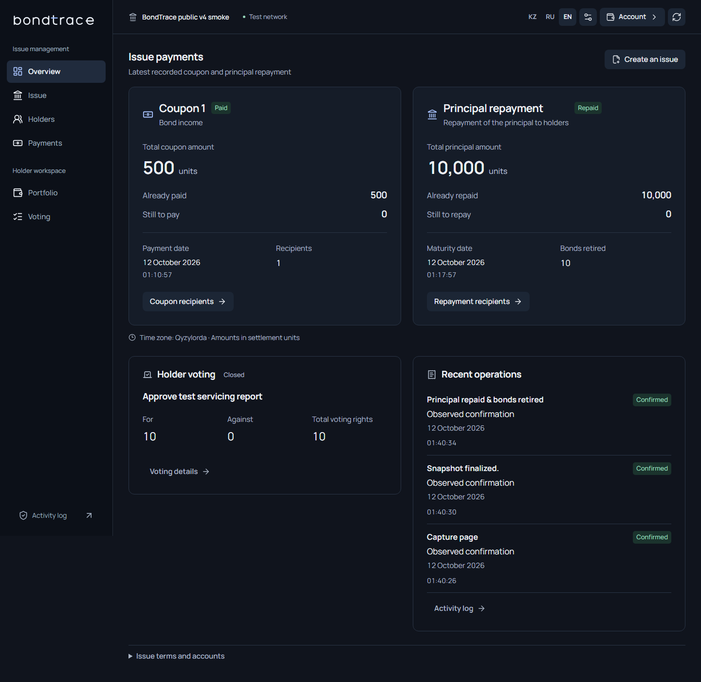
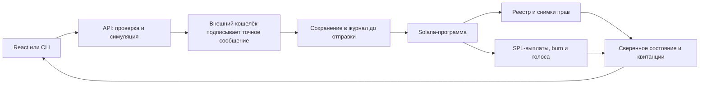

# BondTrace

[English](README.md) · **Русский**

**От зафиксированного права держателя до проверяемой выплаты.**

BondTrace — работающий прототип корпоративных действий на **Solana** для **Superteam Kazakhstan × KASE**. Он обслуживает облигацию после выпуска: выплачивает купоны, погашает номинал с атомарным сжиганием токенов и проводит голосование держателей.

**[Открыть приложение](https://bondtrace-devnet.onrender.com/)** · **[Завершённый выпуск v4](https://bondtrace-devnet.onrender.com/?view=overview&instrument=9AcsZYk2WhSKzuK8m6gwy26Tb4JcWiQ9MpTyaYbfmqqh)** · **[Технический обзор](TECHNICAL.md)** · **[Демо на английском · 2:43](https://youtu.be/arOCHtruN_Q)** · **[Питч · 1:56](https://youtu.be/3t2nP0fGRtI)**

**Проверено в публичном devnet:** 10 тестовых облигаций → **купон 500 + номинал 10 000 + сжигание 10 облигаций**, с записанным голосованием держателя. Все 18 подписей наблюдались в finalized; те же записи сохранились после перезапуска сервиса. [Транзакции](docs/evidence/hosted-v4-lifecycle-20261011.json) · [Восстановление](docs/evidence/hosted-v4-recovery-20261011.json).

## Зачем это нужно

Выпуск создаёт токен. Дальнейшее обслуживание должно определить, кому и сколько причитается, заплатить нужному получателю один раз и сохранить доказательства при переводе токенов, наступлении срока и перезапуске сервиса.

BondTrace связывает эти шаги через on-chain фиксацию прав, точную целочисленную арифметику и восстановление расчётов. Старый купон остаётся доступен после перевода или сжигания облигаций. В v4 любой плательщик комиссии может продолжить наступившую фиксацию: присутствие эмитента при погашении не требуется. Держатель подписывает получение своего номинала и сжигание своих облигаций.

## Попробовать

В приложении доступны выплаты, держатели, голосование и квитанции транзакций. Просмотр не требует пароля. Приложение поддерживает **английский, русский и казахский**, компьютер и телефон, отображение дат в выбранном часовом поясе. Из квитанции можно открыть конкретную транзакцию в Solana Explorer.

Все активы — **синтетические тестовые SPL-токены без фиатной стоимости**. Render Free может засыпать между посещениями. Подключение кошелька само по себе не доказывает успешную транзакцию.

| Поверхность | Подтверждённая область |
|---|---|
| Публичное приложение | Программа v4 и обновлённый интерфейс развёрнуты; публичные JS/CSS совпали с проверенной сборкой. Купон 500, номинал 10 000, burn 10 и голосование выполнены через публичный API: 18 finalized-подписей, прежние ID сохранены после рестарта. [Запись деплоя](docs/33-HOSTED-DEPLOYMENT.md). |
| Текущие исходники | Страничная программа v4, обновлённый многоязычный интерфейс, обслуживание наступивших действий без эмитента и подписанные shadow-адаптеры. Версии исходников и деплоя учитываются отдельно. [Готовность](docs/35-READINESS.md). |
| Обычный Phantom | Реализованы full-wire v0 sign-only путь и проверка подписей. Успешная транзакция через обычный человеческий кошелёк пока не подтверждена. |
| Внешние учреждения | Аттестации реестра, outbox расчётов и подписанные подтверждения работают в sandbox/shadow-сценарии. Живая интеграция с KASE, банком или кастодианом не заявляется. |



*Обновлённое публичное приложение читает завершённый тестовый выпуск v4, 12 октября 2026 года по времени Казахстана. Выполнение подтверждают квитанции по ссылкам; изображение не доказывает подпись человеческого кошелька.*

## Три обязательных сценария

| Сценарий | Что происходит | Что можно проверить |
|---|---|---|
| **Купонная выплата** | Фиксируются количества на record date, рассчитываются права, держатель получает купон или исполнитель отправляет его закреплённому получателю | Снимок, отметка выплаты держателю, SPL-перевод и квитанция |
| **Погашение облигации** | Фиксируются держатели на погашение; выплата номинала и сжигание соответствующего количества выполняются атомарно | Снимок номинала, выплата, burn и оставшиеся обязательства |
| **Голосование держателей** | Фиксируются веса, принимается один голос от держателя, предложение закрывается | Веса, бюллетени и итоги; голосование информационное |

Тестовый инструмент, реестр, record-date механизм, расчёт прав и записи результата реализованы в [Solana-программе](programs/bondtrace/src/v2.rs). [Карта приёмки](docs/08-SPEC.md) охватывает все восемь минимальных требований.

```text
Купон   = облигации на record date × номинал × годовая ставка ÷ частота
Номинал = облигации на погашение × номинал одной облигации

10 × 1 000 × 10% ÷ 2 = 500 за один купон
10 × 1 000           = 10 000 номинала
```

У облигаций 0 десятичных знаков, у расчётного токена — 6. Rust использует checked integers, TypeScript — BigInt, JSON — строки целых чисел. Дробная минимальная расчётная единица отклоняется вместо незаметного округления. Финальный купон и номинал — отдельные права: погашение номинала не удаляет невыплаченный старый купон.

## Как устроено



- **Solana определяет финансовый результат.** Неизменные условия, страницы реестра, снимки, маски выплат и бюллетени обеспечивают выполнение. Classic SPL-облигации заморожены вне контролируемых переводов программы.
- **Расчёты восстанавливаются.** API сохраняет ID операции, подписанные байты и срок транзакции до отправки. Неопределённый исход сверяется перед новым действием. GET-запросы не отправляют транзакции.
- **Метаданные переживают перезапуск хостинга.** Локально используется SQLite; на хостинге — Neon PostgreSQL с защитой единственного писателя. Неопределённый COMMIT блокирует дальнейшую подпись и отправку.
- **Внешние рельсы отделены явно.** Подписанные адаптеры реестра и расчётов обеспечивают аудит и shadow-сверку. Банковское подтверждение не может отметить on-chain обязательство оплаченным или разрешить настоящий банковский платёж.

[Архитектура, даты и арифметика](TECHNICAL.md) · [Протокол и ограничения](docs/34-PAGED-SERVICING.md) · [API](docs/15-API-CONTRACT.md) · [Безопасность](docs/11-SECURITY.md)

## Воспроизвести цикл v4

Для **Windows x64 + PowerShell 7 + Node 22.14.0 + WSL2/Ubuntu 24.04**:

```powershell
git clone --depth 1 https://github.com/dimik98330/solana-worldsfair-2026.git
cd solana-worldsfair-2026
npm ci --ignore-scripts
npm run setup:judge
npm run demo:paged:lifecycle
```

Команда собирает программу, запускает изолированный validator/API, создаёт тестовую облигацию, распределяет 10/5/3 единицы, фиксирует права, проводит голосование, перевод, купоны, погашение и старый купон после burn. Используются сгенерированные локальные тестовые подписанты. **Приложение/API: `http://127.0.0.1:3200`; RPC: `http://127.0.0.1:8999`.**

Первая установка toolchain дольше подготовленного запуска. [Настройка и native Linux](docs/LOCALNET-SETUP.md). При прерывании сохраните выданный ID и продолжите с теми же флагами и `-OperationId <id>`; не удаляйте журнал и не создавайте заменяющие выплаты.

## Проверяемые доказательства

| Зафиксированный прогон | Результат | Доказательство |
|---|---|---|
| Публичный devnet v4 | Купон 500, номинал 10 000, 10 сожжённых облигаций; голоса 10 за/0 против; 18 finalized-подписей; те же 17 ID действий и результаты после рестарта | [Транзакции](docs/evidence/hosted-v4-lifecycle-20261011.json), [восстановление](docs/evidence/hosted-v4-recovery-20261011.json) |
| Публичный devnet v3 | 900 купонных единиц, 18 000 номинала, 18 сожжённых облигаций; 26 finalized-подписей; восстановление после перезапуска | [Пакет транзакций](docs/evidence/hosted-devnet-20261009.json) |
| Подготовленный localnet v4 launcher | 1 800 купонных единиц, 18 000 номинала, 18 burned; 37 подписей наблюдались finalized на указанную дату | [Независимая проверка](docs/evidence/servicing-v4-one-command-check-20261010.json) |
| Расширенный localnet v4 | 33 исходных держателя, новый получатель, 9 купонов; 21 600 купонов и 48 000 номинала; старый купон после burn | [Результаты и область](docs/evidence/servicing-v4-localnet-summary-20261010.json) |

Это отдельные сценарии и версии. Поздние RPC-запросы не всегда возвращают старые статусы; исходные квитанции и время наблюдений сохранены. [История проверок](docs/VERIFICATION-HISTORY.md) содержит точные ревизии, неудачные попытки, результаты тестов и исключения.

```powershell
npm run typecheck
npm test
npm run test:ui
npm run build
npm run test:program
# Необязательная одноразовая PostgreSQL fixture; никогда не рабочая БД:
npm run test:postgres
```

Тесты проверяют точные права, переполнение/остатки, record locks, чужие полномочия, повторные выплаты/голоса, незавершённую фиксацию, старые права после burn и восстановление хранения. Они сохранены для проверки и воспроизведения прототипа.

## Границы прототипа

Это обслуживание permissioned тестовых облигаций, не промышленная площадка ценных бумаг. Обычные SPL/DEX-переводы, юридическое владение/KYC, фиатное хранение, настоящий институциональный пилот и промышленная доступность находятся за пределами демонстрации. Страница протокола содержит 8 записей; интерфейс принимает до 16 купонов; полное API-чтение ограничено 4 096 наблюдениями аккаунтов. Безграничная масштабируемость не заявляется.

Новое [непрерывное демо на английском](https://youtu.be/arOCHtruN_Q) показывает завершённый выпуск **публичного devnet** с настоящими нажатиями в браузере. [Отдельный питч](https://youtu.be/3t2nP0fGRtI) объясняет продукт и опыт автора. Синтетическая английская озвучка указана явно; новых выплат и подписания человеческим кошельком в демо нет. [Происхождение и область видео](docs/13-DEMO.md).

[Русское демо с голосом автора · 2:30](https://youtu.be/Izo33Mry-hc) также доступно на YouTube: один непрерывный дубль завершённого **localnet**-выпуска. [Английский тред о проекте](https://x.com/dimasmitth/status/2109595448805835134) объясняет назначение, работу и способы проверки.

Владелец отправил BondTrace на **Colosseum Crypto World's Fair** и в отдельный **Superteam Kazakhstan × KASE side track** 12 октября 2026 года. Colosseum показывает **Submitted / entered for judging**; в KASE появилась **Edit Submission**, все 12 сохранённых полей проверены повторно. Официальная оценка, приз и одобрение KASE не заявляются. [Записи о подаче](docs/14-SUBMISSION.md).

## Структура репозитория

`apps/web` — React · `server` — API, восстановление и хранение · `programs/bondtrace` — Anchor · `packages/client` — типизированный клиент и точная арифметика · `tests` — поведение и ошибки · `scripts` — запуск и воспроизведение · `docs/evidence` — версионные доказательства.

[Документация](docs/README.md) · [Хостинг и восстановление](docs/31-HOSTING.md) · [История уборки](docs/PUBLICATION.md)
